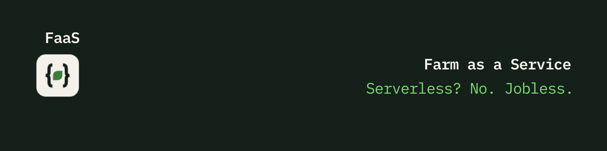

<p align="center">
  
</p>

<p align="center">
  <a href="LICENSE"></a>
  <a href="CONTRIBUTING.md"></a>
  
  
  
  
</p>

# Farm as a Service (FaaS)

> Serverless? No. Jobless. **FaaS: Farm as a Service.**

An open source guide for developers and tech people who want to start a farm,
a homestead, or a smallholding. Maybe you are burnt out. Maybe you got laid
off. Maybe you just want to touch soil instead of YAML. This guide tells you
what it costs, how long it takes, and what will go wrong. The jokes are in the
headings. The advice is real.

## Quickstart

```console
$ faas init my-farm
✔ Checking soil... clay. It is always clay.
✔ Provisioning hens... 6 instances running
✔ Deploying courgettes... done
⚠ Warning: courgettes scaled to 400 instances. No way to scale down.
⚠ Warning: unauthorised access attempt on henhouse-1 (source: fox)

$ faas rollback
Error: rollback not supported. You cannot un-plant a field.

$ sudo make hay
make: *** No sunshine. Stop.

$ faas logs --tail
05:02 rooster: COCK-A-DOODLE-DOO
05:02 rooster: COCK-A-DOODLE-DOO
05:03 rooster: COCK-A-DOODLE-DOO

$ faas status
goat-1    RUNNING   (location: unknown)
goat-2    RUNNING   (location: your neighbour's roses)
```

There is no CLI. There is a spade. Start with the
[Reality check](docs/00-reality-check.md).

## System requirements

| Component | Minimum | Recommended |
| --- | --- | --- |
| Storage | 10 m² of soil | A shed. Then a bigger shed. |
| Memory | A notebook | A notebook you can find |
| Power | One human, 2 hours a week | One human who likes mornings |
| Cooling | Built in. It is called weather. | A hat |
| Network | The neighbour who has farmed for 40 years | Same. No faster network exists. |
| Display | A window | No window. You are outside. |
| OS | Any. Boots get muddy on all of them. | |

## The FaaS glossary

| Dev term | Farm term |
| --- | --- |
| Cold start | 5am in winter |
| Auto-scaling | Rabbits |
| Pay per use | The feed bill |
| Vendor lock-in | Land in the middle of nowhere |
| Uptime | Cows don't do weekends |
| Incident | Fox in the henhouse |
| On-call rotation | Lambing season. You are the rotation. |
| Rollback | Not supported. You cannot un-plant a field. |
| Technical debt | The fence you will fix "next weekend" |
| Legacy system | The tractor. Older than you. Still in production. |
| Garbage collection | Mucking out |
| Monitoring | Walking the fence with a coffee |
| Free tier | Courgettes in August. Please, take some. |
| Production outage | Frost in May |
| Memory leak | The water trough. It is always the water trough. |
| Scheduled downtime | January |
| Breaking change | Goats |
| Cron job | The rooster. Runs at 5am. Cannot be disabled. |
| Firewall | Electric fence |
| Zero-day | Slugs found the seedlings on the night you planted them |
| DDoS | Pigeons |
| Bug | Bug. An actual bug. Thousands of them. |
| Git blame | Who left the gate open? |
| Merge conflict | Two rams, one field |
| Fork | Fork |
| Root access | Carrots |
| The cloud | The cloud. It decides everything. No SLA. |
| Cache | The freezer |
| Tech stack | Hay stack |
| Stack overflow | The muck heap |
| Kubernetes | A sheepdog. Orchestrates the herd. Also takes years to learn. |
| Cattle, not pets | Finally, literal |
| Yak shaving | Sheep shearing. Also literal. |
| Bikeshedding | Shed building. You will still argue about the colour. |
| Rubber duck debugging | Ducks. They listen. They do not help. |
| Sprint | You, behind an escaped goat |
| Stand-up | The whole day |
| Dark mode | 4pm in December |
| Open source | The seed swap |
| Deprecated | The old hen. Still running. No longer shipping. |
| Works on my machine | Works on my soil |

## Start here

Read these in order. The first one is the important one.

| # | Page | What you get |
| --- | --- | --- |
| 00 | [Reality check](docs/00-reality-check.md) | Cost, time, physical work, income. The honest page. |
| 01 | [Starting paths](docs/01-starting-paths.md) | Hobby plot, homestead, or small business. Budget and hours for each. |
| 02 | [Land](docs/02-land.md) | Buy vs rent, size, soil, water, planning rules. |
| 03 | [First things](docs/03-first-things/) | What to grow or keep first. One page each, same template. |
| 04 | [Tools and equipment](docs/04-tools-and-equipment.md) | The year-one list, and what can wait. |
| 05 | [Money](docs/05-money.md) | Selling, markets, farm shops, general tax notes. |
| 06 | [Farm tech](docs/06-farm-tech.md) | Sensors, Home Assistant, irrigation, spreadsheets, open source software. |
| 07 | [Stories](docs/07-stories/) | Short posts from people who made the switch. |

### 03: First things (pick your first deploy)

| Guide | One-line summary |
| --- | --- |
| [Vegetables](docs/03-first-things/vegetables.md) | Cheapest start. Fastest feedback loop. |
| [Fruit](docs/03-first-things/fruit.md) | Plant once, wait years, harvest for decades. |
| [Chickens](docs/03-first-things/chickens.md) | The "hello world" of livestock. |
| [Bees](docs/03-first-things/bees.md) | 40,000 workers. No stand-ups. |
| [Goats](docs/03-first-things/goats.md) | Penetration testers for your fencing. |
| [Sheep](docs/03-first-things/sheep.md) | Lawn mowers that need a vet. |

### Country-specific

General advice lives in `docs/`. Laws, subsidies, and tax live in
[`countries/`](countries/README.md).

- [United Kingdom](countries/uk/README.md) (starter, needs help)
- [Philippines](countries/ph/README.md) (starter, needs help)
- Your country here. See [how to add it](countries/README.md).

### Templates

- [Guide page template](templates/guide-page.md)
- [Story template](templates/story.md)

### Brand

Logos, icons, and banners are in [`assets/`](assets/README.md). Use them for
talks, posts, and forks.

## Status codes

| Code | Meaning on a farm |
| --- | --- |
| 200 OK | Eggs in the nest box |
| 202 Accepted | Seeds are in. Response expected in 3 to 5 months. |
| 301 Moved Permanently | The sheep. They live next door now. |
| 402 Payment Required | The vet |
| 403 Forbidden | Planning permission |
| 404 Not Found | The goat |
| 408 Request Timeout | Apple trees. Try again in 5 years. |
| 409 Conflict | Two cockerels |
| 418 I'm a teapot | Tea break. Not optional. |
| 429 Too Many Requests | Courgettes |
| 500 Internal Server Error | The tractor will not start |
| 503 Service Unavailable | Hens in winter |
| 504 Gate Way Timeout | You left the gate open |

## FAQ

**Does it scale?**
Rabbits do. Your back does not.

**Is there an API?**
Yes. You shake a bucket of feed. Everything comes running.

**Can I run it in a container?**
Tomatoes, yes. Sheep, no.

**Tabs or spaces?**
Rows or raised beds. The flame war is older than computers.

**Vim or Emacs?**
Spade or fork. Same answer: whichever one you already hold.

**Is it AI-powered?**
The chickens run on a very small neural network. It is mostly about corn.

**What is the SLA?**
Best effort. Nature does not sign contracts.

**Can I move fast and break things?**
You can move slowly and things will break anyway.

**Where is the undo button?**
It is called next year.

## Roadmap

- **v0.1** A README and a dream. You are here.
- **v0.2** Real numbers from real people replace the `TODO` markers.
- **v0.5** Ten country folders.
- **v1.0** Someone who owns goats approves the goat page.
- **v2.0** Rewrite it in Rust. Like the tractor.

## How to read the numbers

- Money figures are rough ranges, not quotes. Prices change by country and year.
- Where we are not sure, the page says `TODO: needs source`. We would rather
  show a gap than guess.
- If you see a wrong number, [open a fix-fact issue](https://github.com/alirezahamid/farm-as-a-service/issues/new/choose).
  That is the most useful thing you can do here.

## How to contribute

This guide only works if people who have done it write it. If you keep hens,
bees, goats, or a spreadsheet of your veg yields, we want your numbers.

One rule: **share real experience or cite a source. No guesses.**

Read [CONTRIBUTING.md](CONTRIBUTING.md) for how to add a guide page, a country
folder, or your own story. Please also read the
[Code of Conduct](CODE_OF_CONDUCT.md).

Not ready to write a page? These help too:

- Fix a number and say where yours came from.
- Fill in a `TODO: needs source`.
- Tell us what went wrong on your farm. Failure stories teach the most.

## License

Content is licensed under [CC BY-SA 4.0](LICENSE). Share it, remix it, credit
it, keep it open.

## Disclaimer

This is a community guide, not professional advice. It is not legal, tax,
veterinary, or financial advice. Check your local rules. Call a vet when the
animal looks wrong. Do not quit your job because of a README.
